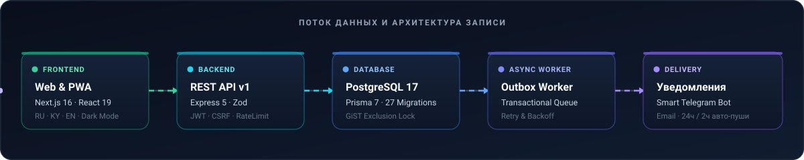
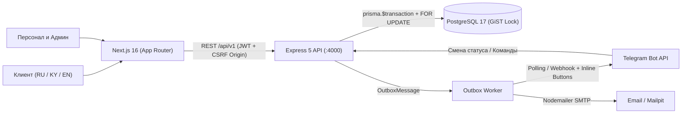

<div align="center">



<br/>
<br/>

[-339933?style=for-the-badge&logo=nodedotjs&logoColor=white)](./.nvmrc)
[](./backend/tsconfig.json)
[](./backend/package.json)
[](./frontend/package.json)
[](./frontend/package.json)
[](./backend/prisma/schema.prisma)
[](./docker-compose.yml)
[](./frontend/package.json)

[](./docs/SEC/REPORT.md)
[](./docs/PROJECT_STATE.md)
[](./docs/TRANSLATIONS.md)
[](./README.md)

<p>
  <a href="#инженерные-гарантии">Гарантии</a> &nbsp;·&nbsp;
  <a href="#возможности-платформы">Возможности</a> &nbsp;·&nbsp;
  <a href="#умный-telegram-бот-второй-веб">Telegram-бот</a> &nbsp;·&nbsp;
  <a href="#архитектура-и-стек">Архитектура</a> &nbsp;·&nbsp;
  <a href="#безопасность-и-качество">Безопасность</a> &nbsp;·&nbsp;
  <a href="#быстрый-старт-за-5-минут">Быстрый старт</a> &nbsp;·&nbsp;
  <a href="#демо-доступы-dev">Демо</a> &nbsp;·&nbsp;
  <a href="#доступные-команды">Скрипты</a> &nbsp;·&nbsp;
  <a href="#документация">Документация</a>
</p>

</div>

---

**Zapis.kg** — multi-tenant SaaS-платформа для онлайн-записи, CRM-учёта клиентов, ручного учёта оплат и оперативного управления через **Умный Telegram-бот** для барбершопов (`BARBERSHOP`) и салонов красоты (`BEAUTY_SALON`) Кыргызстана.

> [!NOTE]
> **Рыночные стандарты по умолчанию:** часовой пояс `Asia/Bishkek` (`UTC+6`), валюта `KGS` (`сом`), телефоны в формате `E.164` (`+996...`), мультиязычный клиентский интерфейс (`RU` / `KY` / `EN`) и переключатель языка в кабинете персонала.

---

## Инженерные гарантии

<table>
  <tr>
    <td width="50%" valign="top">
      <h3>🔒 Строгая изоляция арендаторов</h3>
      Каждый запрос персонала ограничивается <code>companyId</code> из верифицированного JWT, а публичные маршруты — по slug компании или manage-токену. Доступ к объектам другого салона всегда возвращает <code>404 NOT_FOUND</code>.
    </td>
    <td width="50%" valign="top">
      <h3>🗓️ Ноль двойного бронирования (BR-1 / BR-12)</h3>
      Защита работает на двух уровнях: строчная блокировка мастера (<code>SELECT ... FOR UPDATE</code>) внутри <code>prisma.$transaction</code> + движковое ограничение PostgreSQL <code>EXCLUDE USING gist</code> по полуоткрытому интервалу <code>[startAt, endAt)</code>. Для выбора «Любой мастер» кандидаты блокируются детерминированно по одному.
    </td>
  </tr>
  <tr>
    <td width="50%" valign="top">
      <h3>⏱️ Единое время UTC</h3>
      База данных (<code>timestamptz(3)</code>) и процессы сервера (<code>TZ=UTC</code>) работают строго в UTC. Бизнес-логика получает время только через <code>backend/src/lib/clock.ts</code> (<code>FakeClock</code> в тестах), а перевод в локальное время (<code>Asia/Bishkek</code>) выполняется только на границах.
    </td>
    <td width="50%" valign="top">
      <h3>📬 Transactional Outbox и защита данных</h3>
      Все внешние уведомления (Telegram, Email) ставятся в очередь <code>OutboxMessage</code> внутри бизнес-транзакции — сбой внешнего провайдера не ломает запись. Просрочка тарифа переводит кабинет в read-only (<code>402 SUBSCRIPTION_LOCKED</code>), никогда не удаляя данные.
    </td>
  </tr>
</table>

---

## Возможности платформы

<table>
  <tr>
    <td width="50%" valign="top">
      <h4>📅 Онлайн-запись и расписание</h4>
      <ul>
        <li>Публичный степпер <code>/b/[slug]</code> и управление визитом по токену <code>/manage/[token]</code></li>
        <li>Мульти-услуги в одной записи и пакеты/комплексы услуг (<code>ServicePackage</code>)</li>
        <li>Индивидуальные цены и длительность услуг у каждого мастера</li>
        <li>Умный подбор слотов и режим «Любой свободный мастер»</li>
        <li>Полный жизненный цикл визита: <code>PENDING → CONFIRMED → IN_PROGRESS → COMPLETED / NO_SHOW / CANCELLED</code></li>
        <li>Поддержка предоплаты и автоматическое истечение неоплаченных броней</li>
      </ul>
    </td>
    <td width="50%" valign="top">
      <h4>👥 CRM, клиенты и брендинг</h4>
      <ul>
        <li>Сегменты (<code>NEW</code>, <code>REPEAT</code>, <code>VIP</code>, <code>AT_RISK</code>, <code>LOST</code>, <code>NO_SHOW_RISK</code>, <code>BLOCKED</code>) и кастомные теги клиентов</li>
        <li>Недеструктивное объединение дубликатов (<code>preview → execute</code> под <code>FOR UPDATE</code>)</li>
        <li>CSV-импорт клиентов до 500 строк и безопасный CSV-экспорт (<code>clients.csv</code>, <code>payments.csv</code>) с защитой от формул</li>
        <li>Глобальный быстрый поиск <code>⌘K</code> по записям, клиентам и услугам</li>
        <li>Портфолио мастеров с перекодированием изображений в WebP (<code>sharp</code>)</li>
        <li>Тёмная тема кабинета, брендинг салона и кастомные домены на тарифе <code>PRO</code></li>
      </ul>
    </td>
  </tr>
  <tr>
    <td width="50%" valign="top">
      <h4>💳 Оплаты, чеки и SaaS-биллинг</h4>
      <ul>
        <li>Раздельный ручной учёт оплат бизнеса (<code>BusinessPayment</code>: <code>PAYMENT</code>, <code>PREPAYMENT</code>, <code>REFUND</code>)</li>
        <li>Приватное хранилище чеков <code>PaymentProof</code> в PostgreSQL (WebP / проверенный PDF, <code>no-store</code>)</li>
        <li>Тарифная матрица <code>FREE</code> / <code>BUSINESS</code> / <code>PRO</code> (и архивная поддержка <code>START</code>)</li>
        <li>Серверные лимиты (<code>maxStaff</code>, <code>maxServices</code>, визиты и напоминания в месяц — <code>402 PLAN_LIMIT_REACHED</code>)</li>
        <li>Сверка «Подтверждённые поступления» и CRM-отчёт на странице аналитики</li>
      </ul>
    </td>
    <td width="50%" valign="top">
      <h4>🏢 Мультикомпания и админка</h4>
      <ul>
        <li>Общий аккаунт <code>Identity</code> для нескольких филиалов и переключатель <code>CompanySwitcher</code></li>
        <li>Роли персонала <code>OWNER</code>, <code>MANAGER</code> и <code>MASTER</code> + приглашения и менеджер активных сессий</li>
        <li>Верификация email и безопасный сброс пароля по одноразовым SHA-256 токенам</li>
        <li>Изолированная консоль <code>PlatformAdmin</code> (<code>/admin/*</code>) с TOTP 2FA и кодами восстановления</li>
        <li>Read-only impersonation салона (<code>403 IMPERSONATION_READ_ONLY</code> на любые записи) с аудитом действий</li>
      </ul>
    </td>
  </tr>
</table>

---

## Умный Telegram-бот («второй веб»)

Платформа включает полноценный двусторонний Telegram-бот (режимы `polling` и `webhook`) как для команды салона, так и для клиентов:

- **Сотрудникам (`OWNER` / `MANAGER` / назначенный `MASTER`)**: мгновенные уведомления о новых, перенесённых и отменённых записях с **inline-кнопками** смены статуса прямо в чате (`Подтвердить`, `Начать`, `Завершить`, `Не пришёл`, `Отменить`).
- **Мастерам без логина в веб-кабинет**: владелец на `/dashboard/staff` генерирует одноразовую ссылку-привязку (`POST /api/v1/staff/:id/telegram-link-code`) — мастер привязывает Telegram в 1 клик.
- **Клиентам**: подключение бота в 1 клик сразу после записи на `/b/[slug]` или на странице `/manage/[token]`, просмотр и отмена своих визитов в Telegram, а также **бесплатные авто-напоминания за 24 часа и за 2 часа до визита**.

| Команда | Назначение | Кто использует |
| :--- | :--- | :--- |
| `/today` · `/tomorrow` · `/upcoming` | Просмотр расписания с inline-кнопками управления записями | Владелец, менеджер, мастер |
| `/stats` | Сводка по записям и выручке за день | Владелец, менеджер |
| `/companies` | Переключение активной компании (multi-company) | Владелец, менеджер, мастер |
| `/settings` | Пауза или возобновление уведомлений | Персонал |
| `/clear` | Очистка истории сообщений бота в чате | Персонал и клиенты |
| `/start client_<token>` | Привязка клиента к боту для напоминаний 24ч / 2ч | Клиент |

---

## Архитектура и стек

<div align="center">
  
</div>

<br/>

| Слой | Технологии и инструменты |
| :--- | :--- |
| **Runtime & Монорепозиторий** | Node.js `>= 22` (`.nvmrc`: `24`), npm workspaces (`backend`, `frontend`) |
| **Backend API и Worker** | Express `5.3`, TypeScript `~6.0` (`strict: true`, `noUncheckedIndexedAccess`), Prisma `7.10` (`@prisma/adapter-pg`), Zod `4.6`, Argon2id, JWT (`httpOnly` refresh + in-memory access), OTPlib `13.6`, Sharp `0.35`, Helmet `8.3`, Pino `10.4` |
| **База данных** | PostgreSQL `17` + расширение `btree_gist`, `27` SQL-миграций (GiST exclusion и CHECK-ограничения) |
| **Frontend Web (PWA)** | Next.js `16.4` (App Router), React `19.3`, Tailwind CSS `4.3`, shadcn/ui, Zustand `5.1`, React Hook Form `7.92` + Zod, Luxon `3.7`, `qrcode.react` |
| **Тестирование и CI** | Vitest `5.1` + Supertest (интеграционные, конкурентные и security-тесты на `zapis_test`), Playwright `1.65` (Chromium E2E), Docker Compose + Mailpit, GitHub Actions |

<details>
<summary><b>Интерактивная Mermaid-схема и структура монорепозитория</b></summary>



- `backend/` — Express 5 REST API (`/api/v1`) и асинхронный Outbox Worker (`dist/worker/index.js`)
  - `src/modules/` — `admin`, `analytics`, `appointments`, `auth`, `availability`, `billing`, `clients`, `company`, `health`, `media`, `notifications`, `onboarding`, `payments`, `platform`, `public`, `search`, `services`, `staff`, `time-off`
  - `src/cli/` — `create-admin.ts`, `reset-admin-password.ts`, `reset-admin-2fa.ts`
  - `prisma/` — схема БД, `27` миграций и идемпотентный demo-seed
  - `tests/` — `unit/`, `integration/`, `security/` (запуск против изолированной БД `zapis_test`)
- `frontend/` — Next.js App Router веб-приложение
  - `src/app/` — Лендинг (`/`), Авторизация (`/login`, `/register`, `/forgot-password`, `/reset-password`, `/verify-email`), Кабинет (`/dashboard/*`), Админка (`/admin/*`), Публичная запись (`/b/[slug]`, `/manage/[token]`), Правовые страницы (`/privacy`, `/terms`)
  - `e2e/` — `28` сквозных сценариев Playwright Chromium
- `scripts/` — единый оркестратор качества `gate.mjs` (`npm run gate` / `gate:full`) и статические проверки `autopilot-guard.mjs`
- `docs/` — спецификация API, архитектурные решения, отчёты QA/безопасности и эксплуатационные инструкции

</details>

---

## Безопасность и качество

Платформа прошла комплексный аудит по **OWASP Top 10:2025** и чек-листу **OWASP ASVS Level 2** ([отчёт по аудиту](docs/SEC/REPORT.md), [политика безопасности](docs/SECURITY.md)):

- **Аутентификация и сессии:** хеширование паролей `Argon2id`, access JWT только в памяти Zustand, ротация `httpOnly` refresh cookie с `tokenVersion` и отзывом при повторном использовании, TOTP 2FA для админов с атомарным шагом проверки и lockout-блокировкой.
- **Криптография и токены:** высокоэнтропийные одноразовые токены сброса пароля, приглашений, manage-ссылок и Telegram-кодов (хеширование `SHA-256` в БД, никогда не попадают в логи), шифрование секретов `AES-256-GCM` с проверкой 16-байтового тега аутентификации.
- **Периметр и данные:** строгая проверка `Origin` для cookie-эндпоинтов, заголовки безопасности (`CSP`, `X-Content-Type-Options`, `frame-ancestors`), фильтрация null-байтов/управляющих символов, защита CSV-экспорта от formula injection, полная очистка PII во всех таблицах при анонимизации клиента.
- **Автоматический контроль качества (`npm run gate:full`):**
  - `51` файл / `224` backend-теста (`unit` + `integration` с реальным PostgreSQL и гонками потоков)
  - `4` файла / `17` атакующих и регрессионных тестов безопасности (`npm run test:security`)
  - `28` E2E-сценариев в Playwright Chromium
  - TypeScript `strict: true` + `noUncheckedIndexedAccess`, ESLint (`--max-warnings 0`), Prettier

---

## Быстрый старт за 5 минут

### 1. Предварительные требования

- **Node.js `>= 22`** (рекомендуется `24`, см. `.nvmrc`) и **npm**
- **Docker** / Docker Compose (для локального PostgreSQL 17 с `btree_gist` и Mailpit)

### 2. Установка и запуск

```bash
# 1. Установка зависимостей всех workspace-пакетов
npm install

# 2. Создание локальных .env из шаблонов
cp backend/.env.example backend/.env
cp frontend/.env.example frontend/.env

# 3. Запуск PostgreSQL 17 (:5432) и Mailpit (:1025 / UI :8025)
npm run db:up

# 4. Применение всех 27 миграций и загрузка демо-данных (только dev!)
npm run db:reset

# 5. Запуск Backend (:4000) и Frontend (:3000)
npm run dev
```

> [!TIP]
> Для проверки асинхронной отправки уведомлений (Email в Mailpit и Telegram Bot polling/outbox) запустите во втором терминале: `npm run worker`.

### Локальные адреса

| Сервис | URL |
| :--- | :--- |
| **Веб-приложение и CRM-кабинет** | `http://localhost:3000` |
| **Публичная демо-запись** | `http://localhost:3000/b/demo-barbershop` |
| **Панель Platform Admin** | `http://localhost:3000/admin/login` |
| **Backend Healthcheck** | `http://localhost:4000/api/v1/health` |
| **Mailpit (перехват писем)** | `http://localhost:8025` |

---

## Демо-доступы (dev)

> [!WARNING]
> Учётные данные ниже создаются исключительно локальным seed-скриптом [`backend/prisma/seed.ts`](backend/prisma/seed.ts), который принудительно блокирует запуск при `NODE_ENV=production`. Не используйте их в продакшене.

| Роль / Сущность | Логин / Slug | Пароль | Примечание |
| :--- | :--- | :--- | :--- |
| **Демо-компания** | `Demo Barbershop` (`demo-barbershop`) | — | `Asia/Bishkek`, `KGS`, барбершоп |
| **Владелец (`OWNER`)** | `owner@demo.zapis.kg` | `Demo12345!` | Азамат Токтогулов · полный доступ к CRM и биллингу |
| **Мастер с входом (`MASTER`)** | `master@demo.zapis.kg` | `Demo12345!` | Бекзат Исаков · доступ к своему расписанию |
| **Мастер без входа (`MASTER`)** | Нурлан Осмонов (`email: null`) | — | Работает без веб-логина, поддерживает привязку Telegram-бота |
| **Суперадмин (`PlatformAdmin`)** | `admin@demo.zapis.kg` | `AdminDemo12345!` | Вход на `/admin/login` (полностью изолирован от CRM) |

---

## Доступные команды

<details open>
<summary><b>Разработка, тестирование, БД и CLI</b></summary>

| Команда | Описание |
| :--- | :--- |
| `npm run dev` | Одновременный запуск `backend` (`:4000`) и `frontend` (`:3000`) |
| `npm run worker` | Запуск асинхронного Outbox Worker и планировщика напоминаний |
| `npm run build` | Production-сборка `backend` и `frontend` |
| `npm run lint` | Проверка ESLint (`--max-warnings 0`) и Prettier во всех workspace |
| `npm run format` | Автоформатирование кода через Prettier |
| `npm run typecheck` | Проверка типов TypeScript (`tsc --noEmit` + `next typegen`) |
| `npm run test` | Полный набор unit и интеграционных тестов Backend на `zapis_test` |
| `npm run test:security` | Набор security-тестов (`backend/tests/security`) |
| `npm run test:e2e` | Сквозные браузерные тесты Playwright Chromium (`frontend/e2e`) |
| `npm run gate` / `npm run gate:full` | Единый quality-gate (lint, typecheck, test, build, guard, + E2E для `full`) |
| `npm run guard` | Статическая проверка отсутствия `any`, `console.log`, секретов и baseline тестов |
| `npm run db:up` / `npm run db:down` | Запуск / остановка локальных контейнеров PostgreSQL и Mailpit |
| `npm run db:migrate` / `npm run db:seed` / `npm run db:reset` | Миграции, seed и безопасный локальный сброс БД разработки |
| `npm run admin:create` / `admin:reset-password` / `admin:reset-2fa` | CLI-утилиты управления учётными записями `PlatformAdmin` |

</details>

---

## Документация

| Документ | Содержание |
| :--- | :--- |
| [`docs/PROJECT_STATE.md`](docs/PROJECT_STATE.md) | Текущий статус фаз, миграций и результатов проверок |
| [`docs/API.md`](docs/API.md) | Полная спецификация REST API v1 |
| [`docs/DECISIONS.md`](docs/DECISIONS.md) | Журнал архитектурных и продуктовых решений (`DEC-001`..`DEC-048`) |
| [`docs/SECURITY.md`](docs/SECURITY.md) | Политика безопасности, rate-limits, криптография и защита токенов |
| [`docs/SEC/REPORT.md`](docs/SEC/REPORT.md) | Финальный отчёт аудита OWASP Top 10:2025 и ASVS Level 2 |
| [`docs/RUNBOOK.md`](docs/RUNBOOK.md) | Эксплуатация, резервное копирование/восстановление, Outbox и ротация секретов |
| [`docs/ADMIN.md`](docs/ADMIN.md) | Руководство по изолированной панели `PlatformAdmin` |
| [`docs/BILLING.md`](docs/BILLING.md) | Тарифы, квоты, ручной учёт оплат и режим `LOCKED` |
| [`docs/NOTIFICATIONS.md`](docs/NOTIFICATIONS.md) | Transactional Outbox, напоминания и интеграция Telegram/Email |
| [`docs/FEATURES.md`](docs/FEATURES.md) | Каталог реализованных возможностей платформы |
| [`docs/BRON_ROADMAP.md`](docs/BRON_ROADMAP.md) | Дорожная карта развития и апгрейдов продукта |

---

<div align="center">
  
</div>
